# TP4 : Docker et Docker Compose

**JGUIRIM Aya - 3 LIG G4**

## Liens

- GitHub : https://github.com/jguirimaya24-create/MyAppReact
- Docker Hub (serveur) : https://hub.docker.com/r/ayajguirim/mern-server
- Docker Hub (client) : https://hub.docker.com/r/ayajguirim/mern-client

---

## 1. Cloner le projet

J'ai cloné le dépôt MyAppReact. Il contient deux dossiers : Client (React/Vite) et Server (Express).

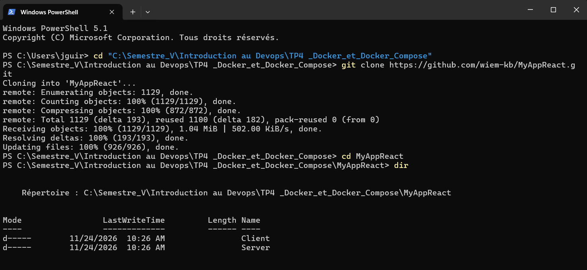

## 2. Créer les Dockerfiles

J'ai créé un Dockerfile dans Server et un dans Client, avec l'image `node:lts-alpine`. Le serveur utilise le port 9000 et `npm start`. Le client fait `npm run build` puis sert le dossier `dist` avec `serve` sur le port 3000. J'ai aussi ajouté un `.dockerignore` dans chaque dossier pour ne pas copier `node_modules`.

## 3. Construire les images

J'ai construit l'image du serveur :

```
docker build -t mern-server ./Server
```

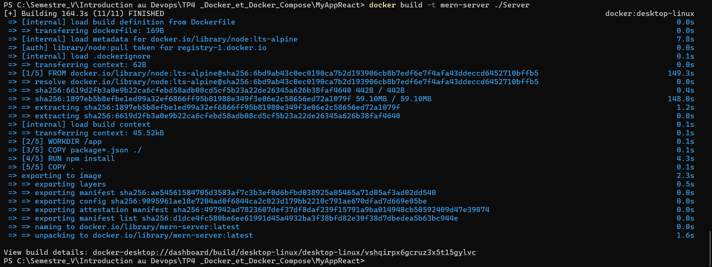

Puis l'image du client :

```
docker build -t mern-client ./Client
```

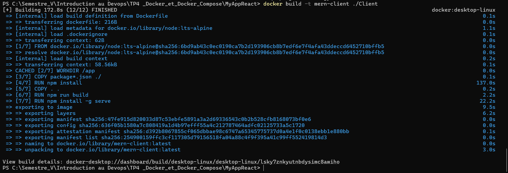

Les deux images sont bien créées :

```
docker images
```

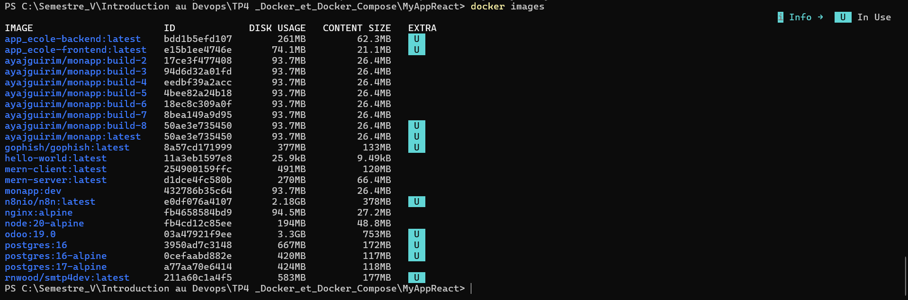

## 4. Créer le réseau Docker

J'ai créé le réseau `mern-network` pour que les conteneurs communiquent entre eux.

```
docker network create mern-network
```

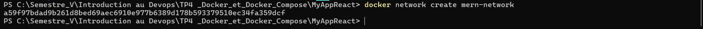

## 5. Lancer MongoDB

Le premier lancement a échoué car le téléchargement de l'image `mongo` a été interrompu (connexion instable).

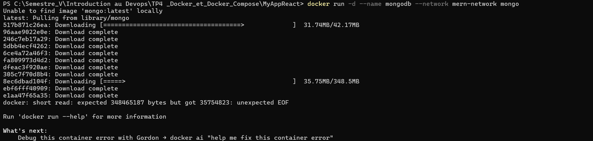

J'ai donc retéléchargé l'image avec `docker pull mongo`.

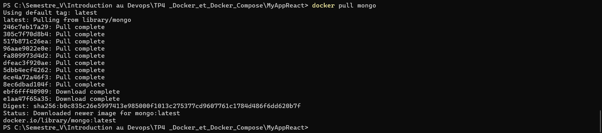

Puis j'ai lancé le conteneur MongoDB sur le réseau :

```
docker run -d --name mongodb --network mern-network mongo
```

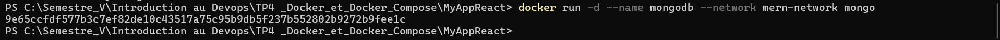

## 6. Lancer le serveur et le client

J'ai lancé le serveur (avec la variable `MONGO_URI`) et le client sur le réseau `mern-network` :

```
docker run -d --name server --network mern-network -p 9000:9000 -e MONGO_URI=mongodb://mongodb:27017/mydb mern-server
docker run -d --name client --network mern-network -p 3000:3000 mern-client
```

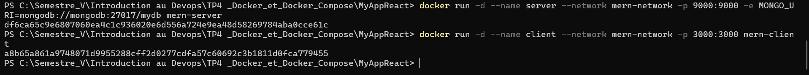

Les trois conteneurs tournent dans Docker Desktop :

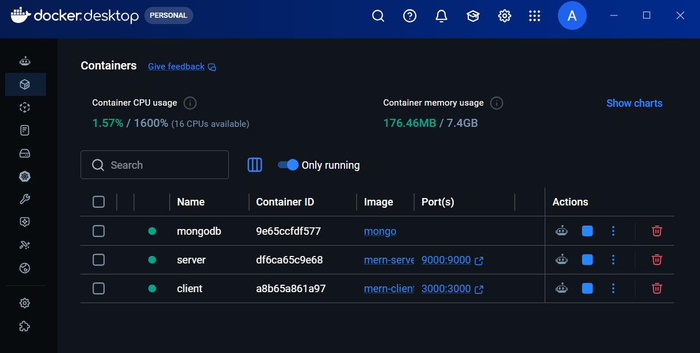

Avec `docker ps` et `docker logs server`, je vérifie que les conteneurs sont `Up` et que le serveur écoute sur le port 9000 :

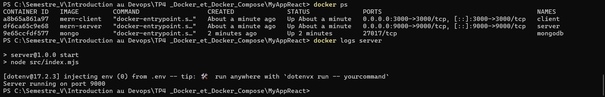

Dans le navigateur, l'API (`localhost:9000/api/health`) et le client (`localhost:3000`) fonctionnent :

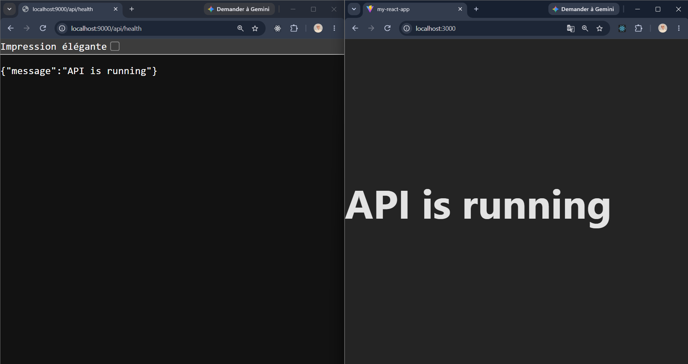

## 7. Docker Compose

J'ai supprimé les conteneurs et le réseau créés à la main, puis j'ai créé le fichier `docker-compose.yml` à la racine du projet. Il définit trois services (mongodb, server, client) et le réseau `mern-network` en mode bridge. J'ai lancé l'application avec :

```
docker compose up --build
```

`docker compose ps` montre les trois services démarrés :

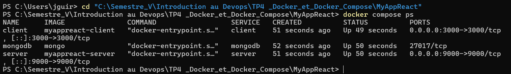

Ils apparaissent aussi dans Docker Desktop :

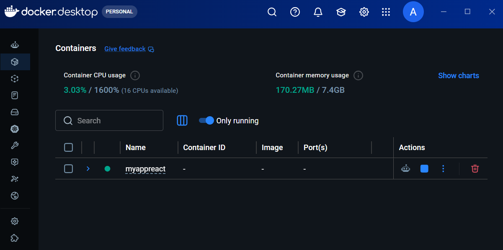

## 8. Envoyer le projet sur GitHub

J'ai configuré mon dépôt GitHub et poussé le projet :

```
git remote add origin https://github.com/jguirimaya24-create/MyAppReact
git add .
git commit -m "TP4 Docker et Docker Compose"
git push -u origin main
```

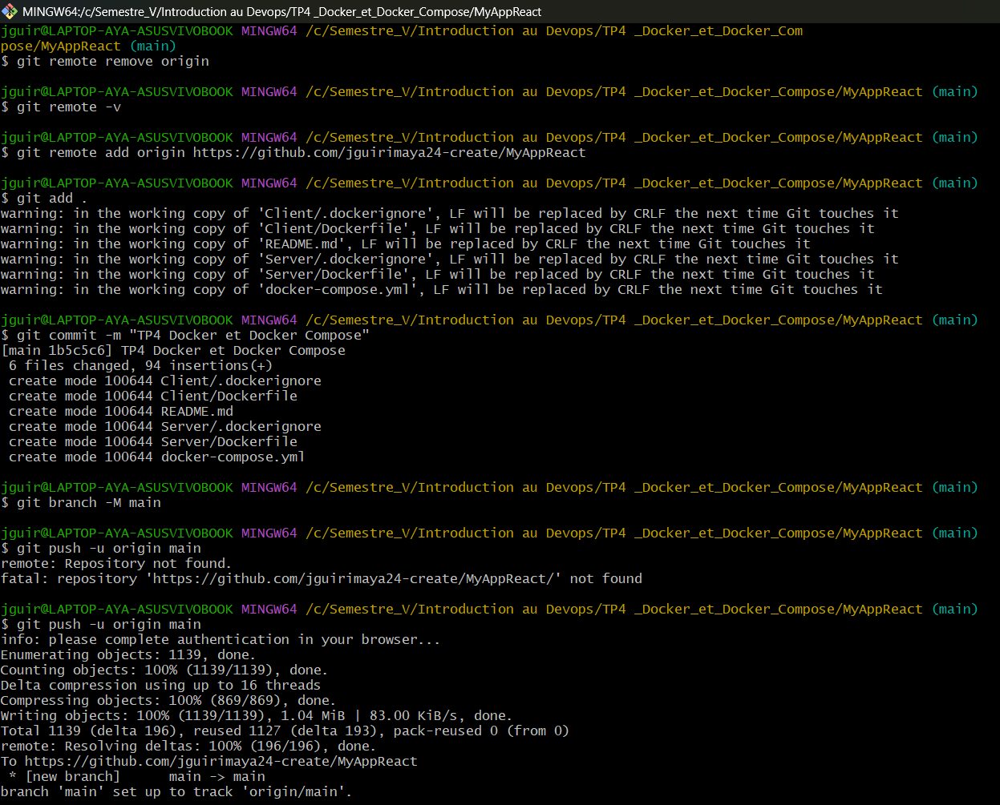

## 9. Envoyer les images sur Docker Hub

Je me suis connectée à Docker Hub et j'ai renommé les images avec mon identifiant :

```
docker login
docker tag mern-server ayajguirim/mern-server:latest
docker tag mern-client ayajguirim/mern-client:latest
```

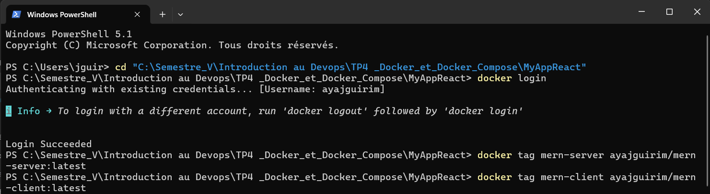

Puis j'ai poussé les deux images :

```
docker push ayajguirim/mern-server:latest
docker push ayajguirim/mern-client:latest
```

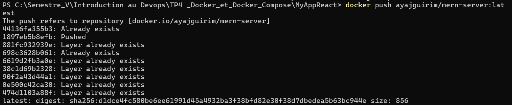

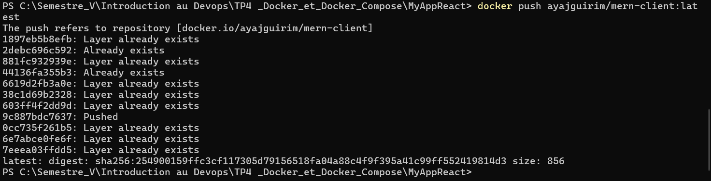

Les images sont visibles sur Docker Hub :

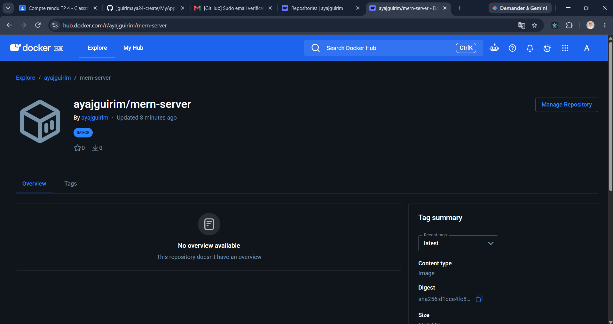

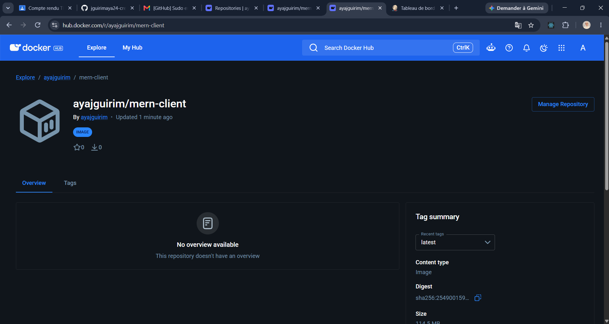

## 10. Pipeline Jenkins

J'ai créé un pipeline Jenkins avec 4 étapes : récupération du code depuis GitHub (Checkout), construction des images (Build images), envoi sur Docker Hub (Push to Docker Hub) et lancement des conteneurs avec docker-compose (Run containers). Toutes les étapes sont passées en vert.

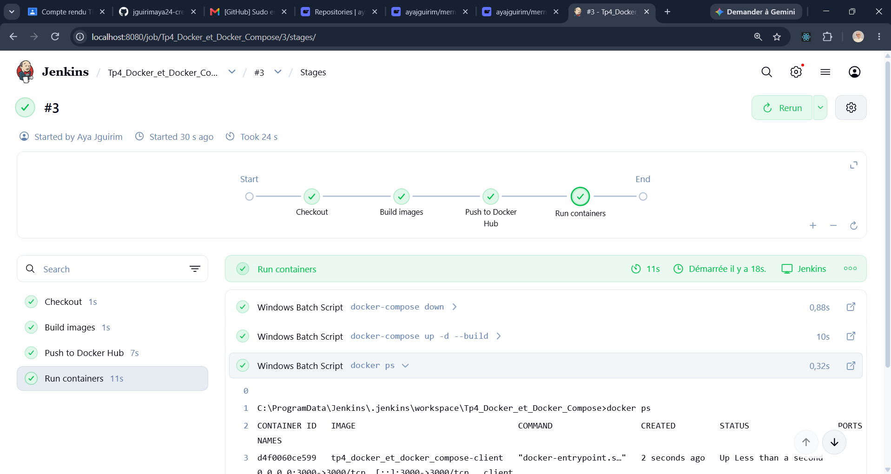

Les conteneurs lancés par Jenkins tournent dans Docker Desktop :

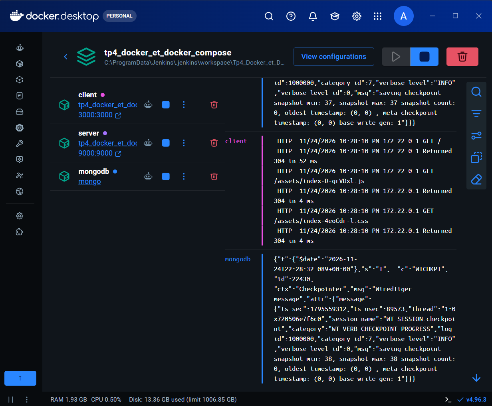

## Remarque

Le serveur fourni n'utilise pas encore MongoDB dans son code. La variable `MONGO_URI` est définie et le conteneur `mongodb` est sur le même réseau, prêt pour une utilisation future.
